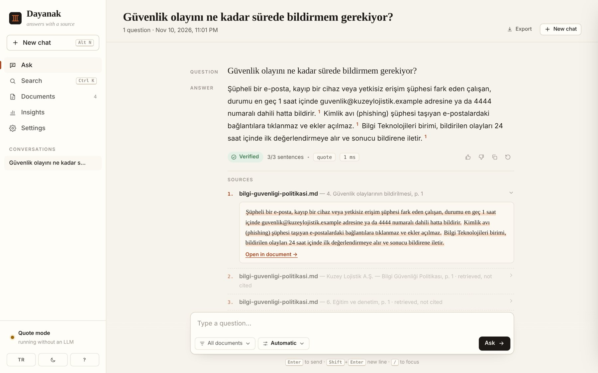
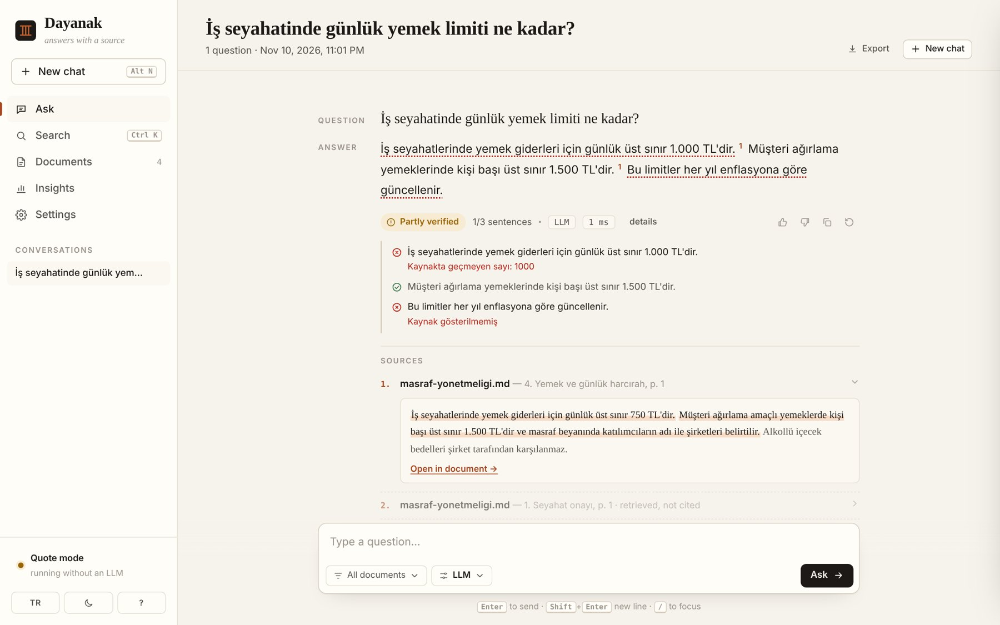
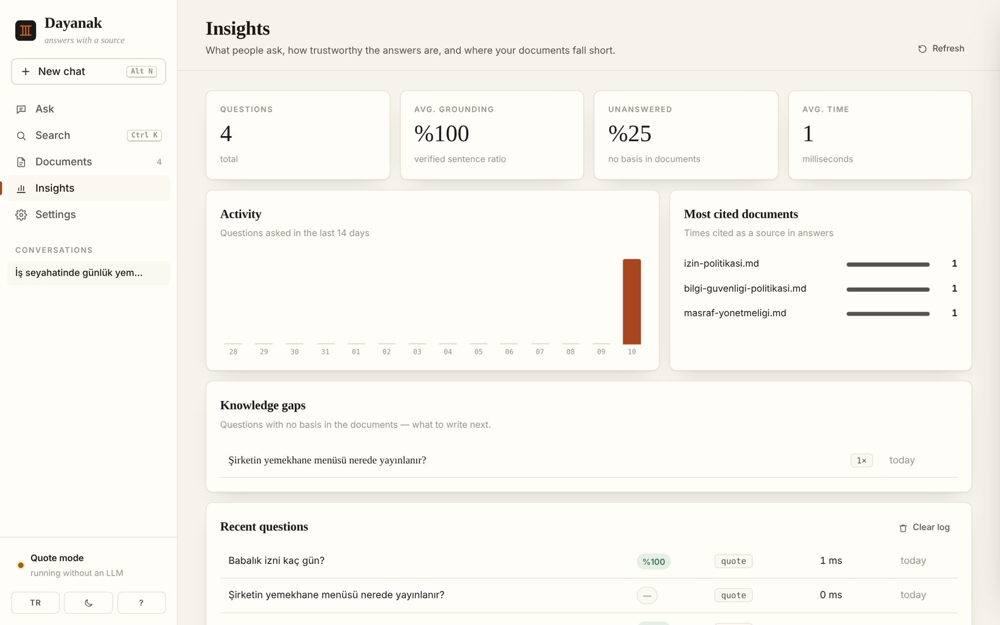
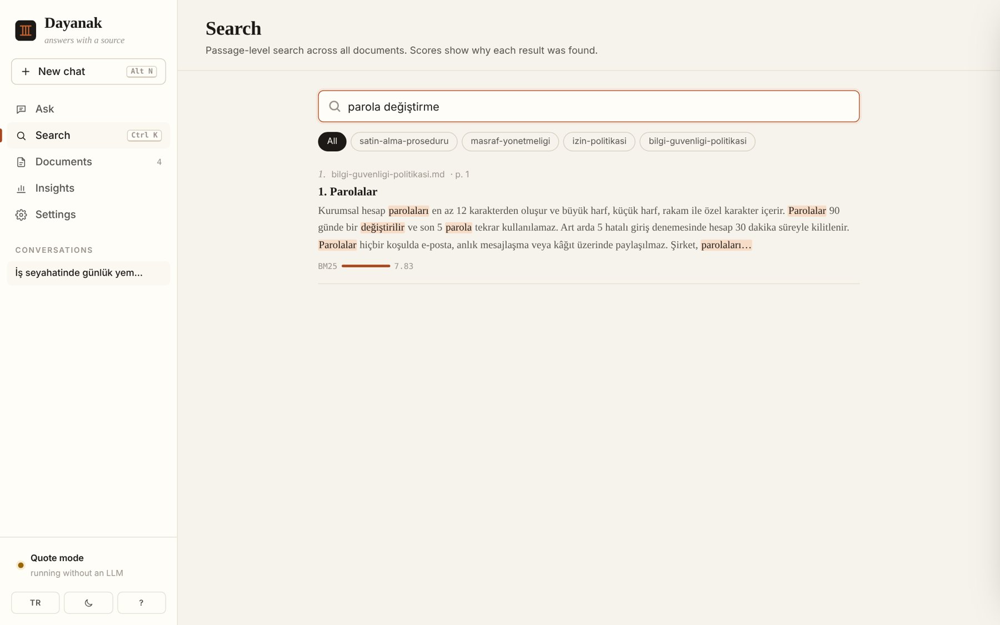
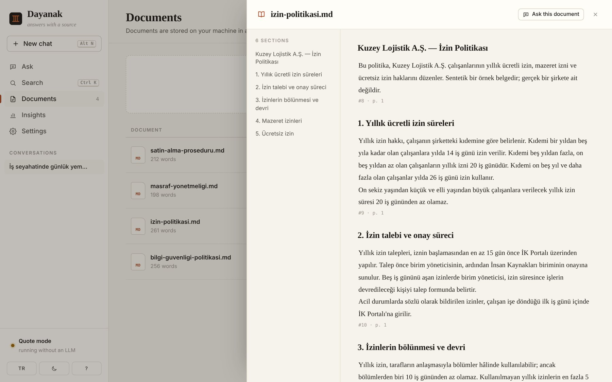
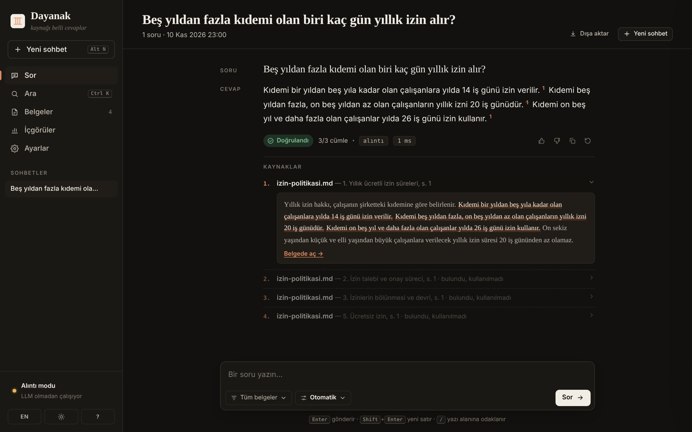
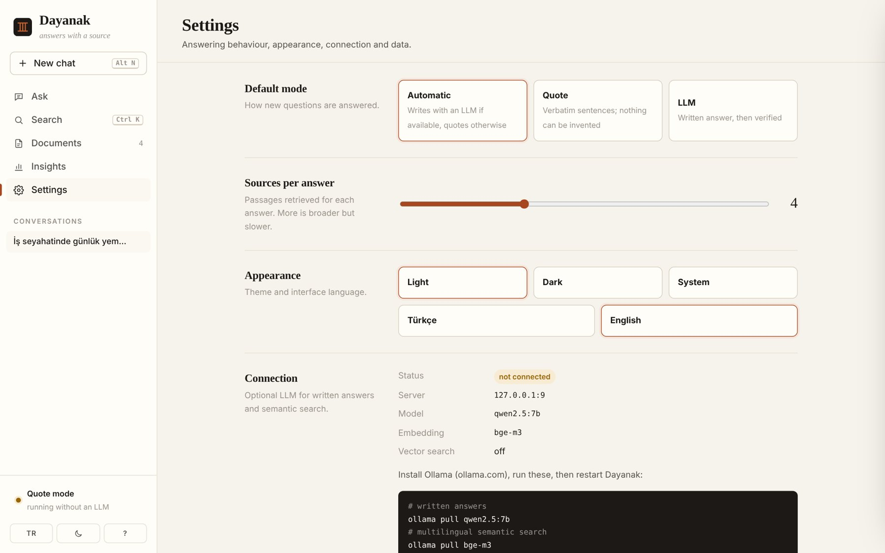

# Dayanak


**Answers from your documents — every sentence cited, every claim checked.**

Ask questions about your own PDFs, Word files and notes. Dayanak finds the relevant passages, answers with sentence-level citations, and then **verifies each sentence against the passage it cites**. Claims it cannot back up, and numbers that do not appear in the source, are flagged in red. Questions the documents do not cover get an honest "no basis found" instead of a confident guess.

> *Dayanak* is Turkish for "basis" or "grounds": the evidence a claim rests on.



> 🇹🇷 **Türkçe özet:** Kendi belgelerinizden (PDF, DOCX, MD, TXT) soru-cevap yapan, her cümlenin kaynağını gösteren ve kaynakla desteklenmeyen iddiaları işaretleyen bir RAG uygulaması. Türkçe için ayarlanmış anahtar kelime araması ve isteğe bağlı vektör araması kullanır. LLM olmadan da alıntı moduyla çalışır.

## Why

Retrieval-augmented generation is the most common way companies put LLMs on top of internal documents. Its classic failure mode is a fluent, well-cited answer that **the cited source does not actually say**. Dayanak treats that as a first-class problem:

| Hallucination guard in action (simulated LLM answer) | Insights: knowledge gaps and answer quality |
|---|---|
|  |  |

The LLM claimed the daily meal limit is 1,000 TL. The cited passage says 750 TL, so the sentence is flagged ("number not in source"). The last sentence cites nothing, so it is flagged too. Groundedness: 33%.

## Features

| | |
|---|---|
| **Ask** | Footnoted answers: every sentence links to its passage; sources listed like a bibliography with the supporting sentences highlighted. A verification badge shows how many sentences were confirmed, with per-sentence reasons on demand. |
| **Scope** | Restrict a question to selected documents ("ask only the security policy"). |
| **Reader** | Open any source in a full document view with an outline of its sections and the cited passage highlighted. |
| **Search** | Passage-level search with document filters and visible BM25 / vector scores, so you can see *why* a passage was found. |
| **Insights** | Questions over time, average grounding, abstention rate, most-cited documents and — most useful for a company — **knowledge gaps**: questions your documents could not answer, grouped and counted. |
| **Feedback & export** | Thumbs up/down per answer (feeds Insights); export a conversation to Markdown with proper footnotes. |
| **Settings** | Default mode, number of sources per answer, theme, language, LLM connection status and data reset. |

Conversations persist in the browser; the query log lives in the same SQLite file as the documents. The UI is a single dependency-free HTML file with an editorial look (serif headings, footnotes, warm paper tones), light and dark themes, Turkish and English, keyboard shortcuts (`Ctrl+K` search, `Alt+N` new chat, `/` focus) and a mobile layout.

| Search with visible scores | Document reader |
|---|---|
|  |  |

| Dark mode | Settings |
|---|---|
|  |  |

## How it works

```
 PDF / DOCX / MD / TXT
          │
   ┌──────▼───────┐   heading-aware passages, 1-sentence overlap,
   │   Chunking   │   page numbers kept for citations
   └──────┬───────┘
          │                    ┌──────────────────────────┐
   ┌──────▼───────┐   query    │ BM25 (Turkish casing,    │
   │   Retrieval  ├───────────►│ prefix stemming)         ├──┐
   └──────┬───────┘            ├──────────────────────────┤  ├─► Reciprocal Rank Fusion
          │                    │ Vector search (optional) ├──┘
          │                    └──────────────────────────┘
   ┌──────▼───────┐   LLM answers only from numbered passages, cites [n]
   │    Answer    │   — or, with no LLM, best sentences are quoted verbatim
   └──────┬───────┘
   ┌──────▼───────┐   per sentence: citation present? citation exists?
   │    Verify    │   term overlap ≥ 60%? every number present in source?
   └──────────────┘
```

| Decision | Why |
|---|---|
| **BM25 always on, vectors optional** | Works offline with zero models. When an embedding model is available, semantic search is fused in with RRF, which needs no score calibration. |
| **Prefix stemming tuned on an eval set** | Turkish is agglutinative. Truncating words to their first *n* letters is a known strong baseline for Turkish IR. *n* = 4, 5, 6 were compared on the eval set; 6 won (with 5, *yemekhane* "cafeteria" collapses into *yemek* "meal"). |
| **Turkish-aware lowercasing** | `"İSTANBUL".lower()` is wrong in Python; `I → ı`, `İ → i` is handled explicitly. |
| **Sentence-level verification** | Cheap, explainable and model-agnostic. A hallucinated number is the most damaging error in policy documents, so a number missing from the source fails a sentence on its own. |
| **Abstention as a feature** | Retrieval score and query coverage thresholds decide when the documents simply do not contain the answer. |
| **Single SQLite file, SHA-256 dedup** | No database server; the same file is never indexed twice. |
| **Provider-agnostic LLM** | Any OpenAI-compatible endpoint: local Ollama (default), OpenAI, Gemini, Groq. |

## Quick start

Runs on **Windows, macOS and Linux**. Requires Python 3.11+.

**Windows:** double-click `start.bat` · **macOS / Linux:** `./start.sh`

The browser opens at **http://127.0.0.1:8100** once the server is ready. Click **"Try with demo documents"** to load four fictional company policies (leave, information security, purchasing, travel expenses) and start asking.

<details>
<summary>Manual setup and CLI</summary>

```bash
git clone https://github.com/numanak-b221210105/dayanak && cd dayanak
python -m venv .venv
.venv\Scripts\activate             # macOS/Linux: source .venv/bin/activate
pip install -e ".[dev]"
python -m dayanak.serve            # web UI + API, docs at /docs

dayanak samples                    # load demo documents
dayanak add policy.pdf handbook.docx
dayanak ask "Yıllık izin talebi kaç gün önceden yapılmalı?"
```
</details>

### Optional: written answers and semantic search

Without an LLM, Dayanak answers in **quote mode**: it returns the best-matching sentences verbatim, so it cannot invent anything. For written answers and multilingual semantic search, install [Ollama](https://ollama.com) and run:

```bash
ollama pull qwen2.5:7b   # answers
ollama pull bge-m3       # multilingual embeddings (re-upload documents afterwards)
```

Any other OpenAI-compatible provider can be configured in `.env` (see `.env.example`).

## API

| Method | Path | Description |
|---|---|---|
| `POST` | `/ask` | `{"question": "...", "mode": "auto" \| "extractive" \| "llm", "k": 4, "doc_ids": [1, 3]}` → answer, citations, per-sentence checks, groundedness, `query_id` |
| `GET` | `/search?q=...&k=5&docs=1,3` | Ranked passages with BM25 / vector / fused scores |
| `POST` | `/feedback` | `{"query_id": 12, "value": 1 \| -1 \| 0}` |
| `GET` · `DELETE` | `/insights` | Usage analytics and knowledge gaps / clear the query log |
| `POST` | `/documents` | Upload one or more files (`files` field) |
| `POST` | `/documents/samples` | Load the demo documents |
| `GET` | `/documents` · `DELETE` `/documents/{id}` | List / delete |
| `GET` | `/documents/{id}/chunks` | Inspect how a document was split |
| `GET` | `/status` | Document count, vector search on/off, LLM connectivity |

```bash
curl -F "files=@policy.pdf" http://127.0.0.1:8100/documents
curl -X POST http://127.0.0.1:8100/ask -H "Content-Type: application/json" \
     -d '{"question": "Parola en az kaç karakter olmalı?"}'
```

## Evaluation

`evals/questions.jsonl` holds 22 questions over the demo documents: 18 answerable (each with the expected source document and expected fact) and 4 that the documents cannot answer.

```bash
python evals/run_eval.py              # quote mode, no LLM needed (runs in CI)
python evals/run_eval.py --mode llm   # with an LLM endpoint
python evals/run_eval.py --embed      # include vector search
```

Results in quote mode (BM25 only):

| Metric | Result |
|---|---|
| Right document ranked first (hit@1) | 100% |
| Expected fact present in answer | 100% |
| Unanswerable questions correctly declined | 4 / 4 |
| Answerable questions wrongly declined | 0 / 18 |
| Answer sentences verified against sources | 100% |

**Caveat:** the stemming length and abstention thresholds were tuned on these same 22 questions, so these numbers are optimistic. A held-out question set is the next step (see roadmap).

## Limitations

- Verification is **lexical**: it catches invented numbers and unsupported content, but not a sentence that reuses the source's words with flipped meaning (e.g. "is covered" vs. "is not covered"). An NLI-based check is on the roadmap.
- Keyword search does not cross languages. English questions over Turkish documents need the multilingual embedding model (`bge-m3`).
- Scanned PDFs (images without a text layer) need OCR first.

## Tests

```bash
pytest -q        # 27 tests, offline
ruff check . && ruff format --check .
```

Tests include a fake LLM that invents a number, omits a citation or cites a non-existent source, and assert that each case is flagged.

## Roadmap

- [ ] Held-out eval set and LLM-mode results
- [ ] NLI-based entailment check alongside lexical verification
- [ ] OCR for scanned PDFs
- [ ] Streaming answers
- [ ] Per-folder collections and access control

## Author

**Numan AK** · Computer Engineering, Sakarya University
[GitHub](https://github.com/numanak-b221210105) · [LinkedIn](https://www.linkedin.com/in/numan-ak-b93555210)

MIT License
